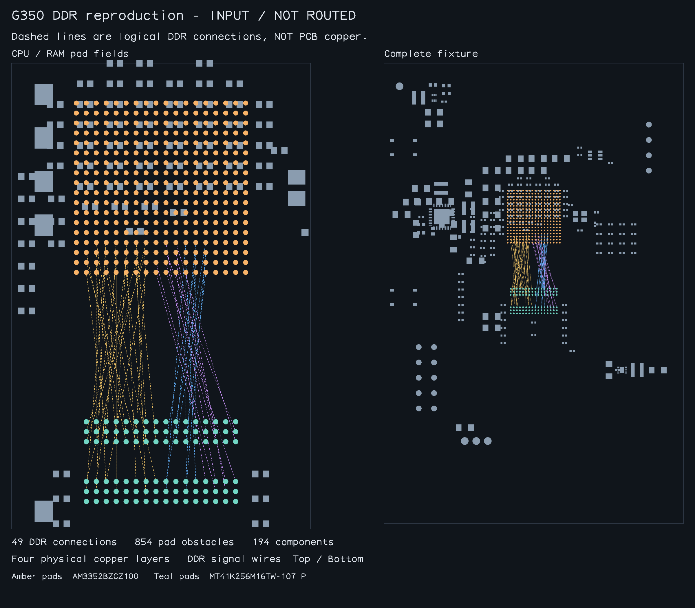

# G350 AM3352 / DDR routing reproduction

A self-contained AM3352BZCZ100 and MT41K256M16TW-107:P placement using the
fixture, loader, CLI and debugger structure of the
[AM3352 SBC reproduction](am3352-sbc-reproduction.md).

## Input

The CPU is at `(0,20)`, rotation 0; RAM is at `(0,-2)`, rotation 270.
Coordinates are board-world millimetres. The fixture contains 194 components
and 854 pads, including all 324 CPU balls and 96 RAM balls, unused/NC pads,
decoupling, power supplies, VREF, ZQ/VTP, clock and reset circuitry.

RAM and its 17 local support components have moved 8 mm down from the original
RAM center `(0,6)` to leave more room between the CPU and RAM. The same `(0,-8)`
translation applies to `R_DDR_ZQ`, `C_DDR_RAM_1` through `C_DDR_RAM_12`,
`C_DDR_RAM_BULK1`, `C_DDR_RAM_BULK2`, `C_VREF_RAM_CA` and `C_VREF_RAM_DQ`,
including their pads, ports and courtyards. All other component positions,
including the CPU bulk capacitors, and the original DDR pin mapping remain
unchanged. `metadata.json` records the original commit, file hashes and exact
component IDs for this placement adjustment.

`tests/fixtures/g350-am3352/circuit.json` contains the netlist and physical
geometry. `native-input.json` contains 49 DDR connections and 68 support nets.
`loadG350Am3352Sample()` selects the 49 DDR connections and retains all pad
obstacles. `loadG350Am3352CompleteInput()` returns the complete capture.
Support-net routing is a separate problem; no fixed copper or cached DDR paths
are supplied.

The PCB has four copper layers. This case restricts DDR wires to Top/Bottom,
with 0.4572 mm lands and 0.254 mm drills on full-depth through-vias.
Trace width and trace-to-pad clearance are 0.1016 mm. BYTE0 and BYTE1 each have
11 signals; command/clock has 26; RESETn is separate. Each synchronous bus has
a 0.635 mm skew bound. DQS0, DQS1 and CK retain 0.127 mm pair skew and 0.12 mm gap.

## Run

```sh
bun install
bun scripts/repro-g350-am3352.ts --timeout-seconds 120 \
  --report /tmp/g350-report.json --output /tmp/g350-routed.json
```

The runner returns nonzero on failure, timeout or failed acceptance. It writes
routing output only after all 49 true-pad connections, copper DRC, layer and
via rules, bus/pair matching and exterior pair coupling pass. Reports measure
planar copper length. Incomplete output has unverified measurements.

Run the fixture and acceptance regression tests with
`bun test tests/g350-am3352-sample.test.ts` and typecheck with
`bun run typecheck`.

For interactive debugging, run `bun start` and open
`g350-am3352-outer-layers`.

## Snapshot



The input snapshot shows the exact fixture placement. Dashed lines represent
logical connections, not routed copper. Regenerate it with:

```sh
bun scripts/snapshot-g350-am3352.ts --input docs/g350-am3352
```

As in the merged SBC reproduction, exporting a routed snapshot requires complete
connectivity and independent DRC and matching acceptance before writing files:

```sh
bun scripts/snapshot-g350-am3352.ts /tmp/g350-routed.json /tmp/g350-snapshot
```

## Fixture verification

File hashes, part identities and component/net mappings are recorded in
`tests/fixtures/g350-am3352/metadata.json`; attribution is in its `LICENSE`.
The optional capture verifier uses Core 0.0.2107 and checks regenerated fixture
bytes without overwriting them. The adjusted coordinates are already stored
in `circuit.json`; capture replay applies no additional placement translation:

```sh
bun scripts/capture-g350-am3352.ts /path/to/core/dist/index.js
```
