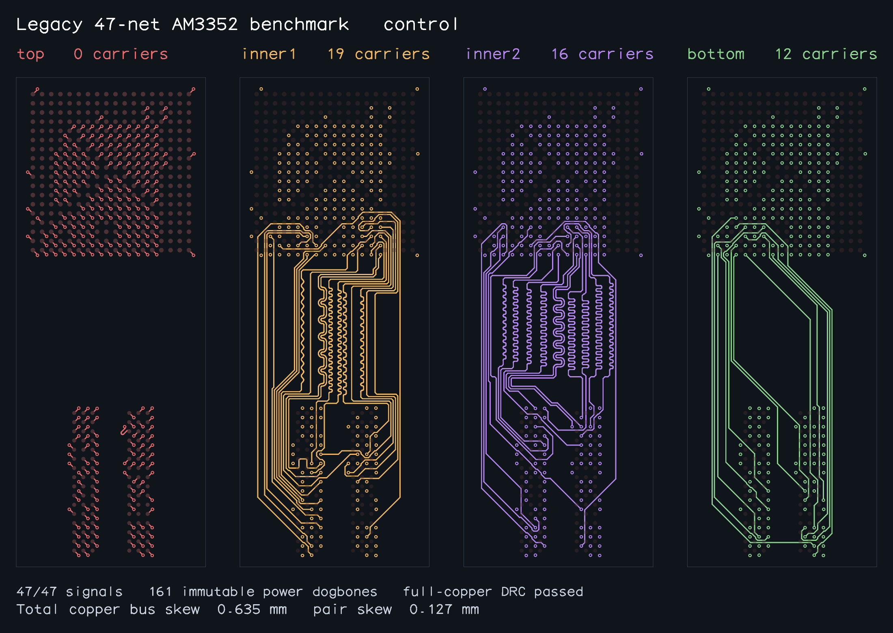
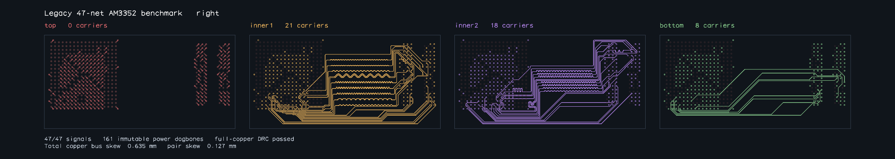
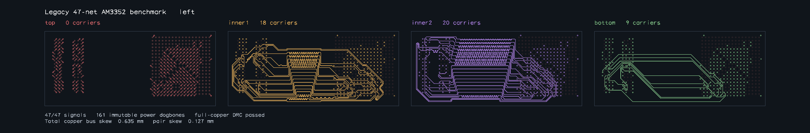
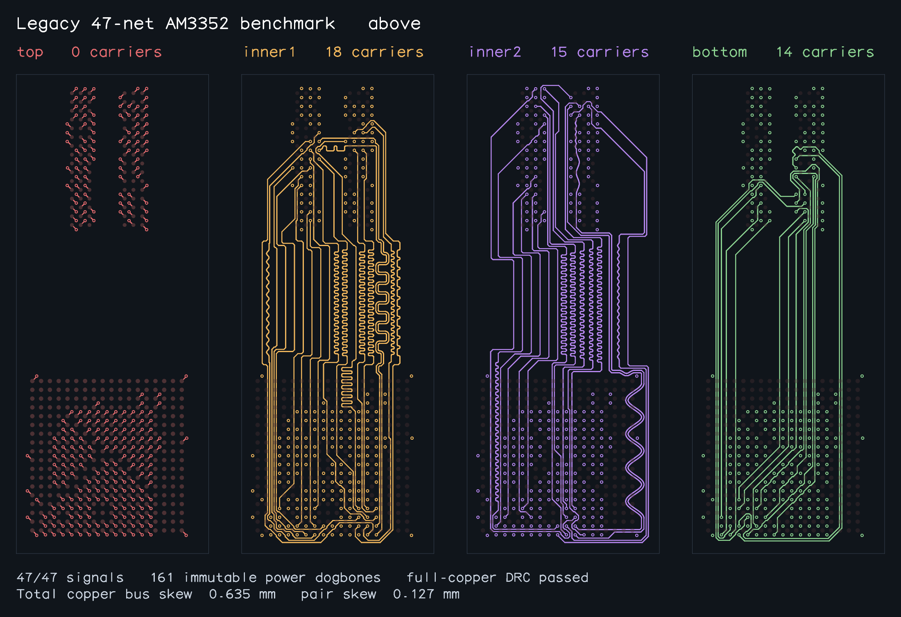
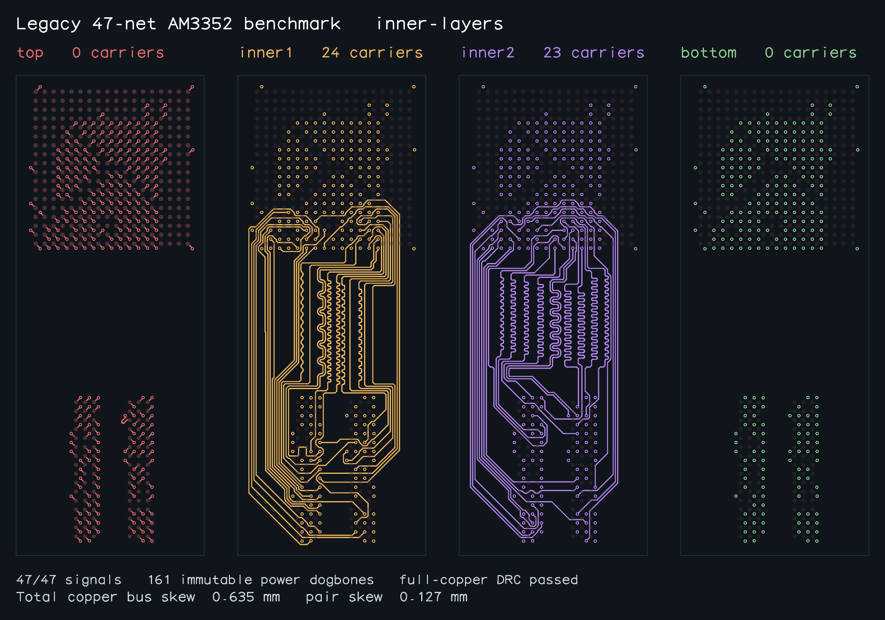

# AM3352 benchmark: current source

**5/11 legacy placements accepted; six timed out.** Each accepted case connects all 47 signals and passes combined copper DRC and full-copper bus/pair matching. The exact 49-signal G350 fresh run was interrupted by an environment restart; no fully accepted G350 route is claimed.

Measured source: local `11526d11fcf72ebe197646cc5090ea1f11ac9e68`, equivalent published `9f3ea4b3711992f27831bd442bb091d866f0b660`, Git tree `df7b629ae550da4485127f0d57ef8199712c9592`. The immutable snapshot verified 920 tracked files. [report.json](report.json) records normalized results, source hashes and accepted snapshot provenance.

Workers ran serially in fresh Bun 1.4.3 processes, with a 180 s solve budget and 195 s parent deadline. The table distinguishes solver time from worker wall time, which includes preparation/validation. A synchronous step can overrun the nominal solve budget. There is no controlled same-budget baseline comparison and no speedup claim.

| Case | Solver s | Worker wall s | Accepted connectivity / DRC / matching |
| --- | ---: | ---: | --- |
| control | 82.658 | 89.548 | 47/47; pass / pass |
| control-inner1 | 190.627 | 191.327 | Timeout; 47 provisional traces, unaudited |
| right | 82.594 | 88.505 | 47/47; pass / pass |
| left | 89.275 | 93.899 | 47/47; pass / pass |
| above | 81.151 | 86.371 | 47/47; pass / pass |
| inner-layers | 121.658 | 124.823 | 47/47; pass / pass |
| inner-layers-right | 181.219 | 181.477 | Timeout; 47 provisional traces, unaudited |
| inner-layers-left | 180.002 | 180.227 | Timeout; 0 provisional traces, unaudited |
| inner-layers-above | 180.000 | 180.238 | Timeout; 0 provisional traces, unaudited |
| inner-layers-complete-ca | 180.000 | 180.275 | Timeout; 0 provisional traces, unaudited |
| outer-layers | unavailable | 195.111 | Worker audit unavailable |

Input immutability and preservation of all 161 supplied fixed fanouts passed **10/10 available worker audits**. The `outer-layers` worker exceeded its parent deadline at 195.111 s and returned no audit; its raw fallback zero counts/solve time and false preservation flags mean unavailable evidence. Timeout rows with `validation.valid: true` cover available input/fixed-copper checks only: completed routing DRC and matching did not pass. Provisional trace counts are not accepted connectivity.

## Full-copper matching

Lengths include supplied fixed fanouts and new interconnect. BYTE0/BYTE1 tolerance is 0.635 mm; each pair tolerance is 0.127 mm. Values below are rounded to six decimals; the JSON retains full precision and the validator verdicts. The complete-CA case timed out, so no command/address/clock bus matching pass is claimed.

| Accepted case | BYTE0 mm | BYTE1 mm | pair_0 mm | pair_1 mm | pair_2 mm |
| --- | ---: | ---: | ---: | ---: | ---: |
| control | 0.635000 | 0.635000 | 0.077868 | 0.127000 | 0.072830 |
| right | 0.635000 | 0.635000 | 0.127000 | 0.121802 | 0.102644 |
| left | 0.635000 | 0.629947 | 0.068825 | 0.127000 | 0.105429 |
| above | 0.635000 | 0.635000 | 0.127000 | 0.127000 | 0.127000 |
| inner-layers | 0.635000 | 0.589950 | 0.077868 | 0.127000 | 0.127000 |

## Layer permissions and G350 scope

These legacy cases use their own layer permissions. `control`, `right`, `left` and `above` retain default permissions and route carriers on inner1/inner2/Bottom; `inner-layers` restricts carriers to inner1/inner2. Their success does not prove the exact G350 49 case with DDR wires restricted to Top/Bottom. The legacy `outer-layers` case timed out.

The proposed G350 stack is L1 Top signals, L2 continuous GND, L3 power/reference planes and L4 Bottom signals. Full-depth through-vias span the planes; they do not permit signal wires on those planes. The explicit within-byte DQ permutation belongs only to the reproduction netlist; the generic solver preserves supplied connectivity. Plane copper, support-net routing, PDN, SI/impedance/return paths, electrical via/package flight time and fabrication are not signed off. Matching here is planar copper length; `fabricationReady` and electrical timing verification remain false.

**Exact G350 49-signal fresh result: interrupted and unaccepted.** The managed environment restarted after the last observed pulse at 3126.112 s of a configured 3600 s run. The process died without a final solver report or accepted output; this was not a 3600 s solver timeout. A post-restart audit verified all 920 working-tree and snapshot files against source `11526d11`. The terminated process's final input hash is unavailable. Progress counters, warm diagnostics and geometric-only routes do not establish independent full-route acceptance.

## Current checks

**Verified full suite: 602 passes, 0 failures** using `taskset -c 0 bun test --timeout 30000`: 191 files, 1,011,346 assertions, 141.21 s. The explicit flag sets Bun's default per-test timeout to 30 s; this is the command that passed.

Separate earlier runs remain recorded: the isolated run using Bun's default timeout had 601 passes and one default 5 s wall-clock timeout (229.19 s); the shared-load run had 599 passes and three timeouts (322.65 s), followed by 6 passing tests across all three affected files with 0 failures. These are separate results, not a single default-timeout 602/0 run. Typecheck and package checks passed, including isolated Node, browser and TypeScript consumers, before the environment interruption.

## Accepted snapshots

The five PNGs below correspond only to completed, independently validated routes and completed visual review. Their SHA-256 hashes and route/input provenance are in the JSON. No failed or provisional route image is included.

### control

### right

### left

### above

### inner-layers

