# Via-count and finite-grid regression

The generic source changes are qualified at `d86215bad2b64ea279660febcbb34ba89f58a83b` (parent `c1151212be7b9de4b34b07436d135d874e6c0466`). Optional actual Via-record skew limits preserve default callers; finite native grids preserve the original search lattice/nearest attachment behavior and fall back to the full grid when necessary. Bounded carrier-bank shaping and cache reoffer keep the original candidates and physical checks.

This documentation-only child contains completed snapshots and provenance. Its production library and all original 913 tracked parent members are byte-identical to the qualified commit. Tests and benchmarks below belong to `d86215ba`; no tests or routes were rerun for this documentation child.

All 11 original `f7428d53` and candidate cases passed 47/47 native connectivity, native combined-copper DRC, full pad-to-pad copper matching and pair coupling. The 161 fixed FanoutSolver traces, vias and pad joins remain immutable. Every route geometry and accepted cache byte is identical between revisions. Existing bus skew limits are 0.635 mm and pair skew limits 0.127 mm, with the original numerical epsilon.

The full suite passed 691 tests with 0 failures and used identical production bytes; the final test-only type fix passed 8 portable tests plus type, read-only formatting and local-tar Node/browser/TypeScript package consumers. Earlier raw failures are preserved separately and are not relabeled.

Native-validated command wall times were 6,143.40 s baseline and 6,681.36 s candidate (+8.76%). Both shared the cloud machine with other work; timings are descriptive and make no causal speed claim.

These are legacy 47-signal test fixtures, including inner-layer cases. They do **not** establish routing, TI compliance, electrical DDR timing or fabrication readiness for the current 49-signal Top/Bottom G350 board. The later source914 enclosed-terminal precheck is excluded.

[Parent source hashes](source-hash-manifest.json) · [Native/comparison/image provenance](provenance.json)

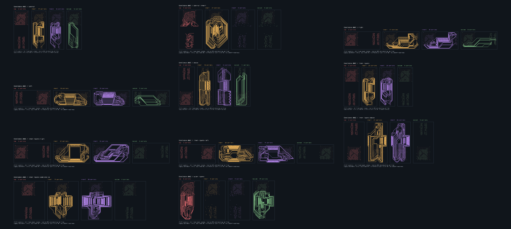

| Sample | Baseline / candidate routing(s) | BYTE0 / BYTE1 skew(mm) | Other declared bus skew(mm) | DQS0 / DQS1 / CK skew(mm) | Native DRC | PNG / SVG |
| --- | ---: | --- | --- | --- | --- | --- |
| control | 75.395 / 70.103 | 0.635000 / 0.635000 | — | 0.077868 / 0.126884 / 0.072830 | Pass | [PNG](images/control-solved.png) / [SVG](images/control-solved.svg) |
| control-inner1 | 2371.637 / 2582.392 | 0.635000 / 0.635000 | — | 0.048900 / 0.004720 / 0.002792 | Pass | [PNG](images/control-inner1-solved.png) / [SVG](images/control-inner1-solved.svg) |
| right | 58.329 / 62.968 | 0.635000 / 0.635000 | — | 0.096047 / 0.121802 / 0.102644 | Pass | [PNG](images/right-solved.png) / [SVG](images/right-solved.svg) |
| left | 85.039 / 116.826 | 0.635000 / 0.511147 | — | 0.010514 / 0.127000 / 0.105429 | Pass | [PNG](images/left-solved.png) / [SVG](images/left-solved.svg) |
| above | 91.846 / 105.124 | 0.635000 / 0.635000 | — | 0.127000 / 0.127000 / 0.127000 | Pass | [PNG](images/above-solved.png) / [SVG](images/above-solved.svg) |
| inner-layers | 134.923 / 134.491 | 0.635000 / 0.635000 | — | 0.077868 / 0.126884 / 0.127000 | Pass | [PNG](images/inner-layers-solved.png) / [SVG](images/inner-layers-solved.svg) |
| inner-layers-right | 194.248 / 235.586 | 0.635000 / 0.635000 | — | 0.127000 / 0.127000 / 0.127000 | Pass | [PNG](images/inner-layers-right-solved.png) / [SVG](images/inner-layers-right-solved.svg) |
| inner-layers-left | 355.031 / 430.366 | 0.634990 / 0.634992 | — | 0.126990 / 0.000001 / 0.105429 | Pass | [PNG](images/inner-layers-left-solved.png) / [SVG](images/inner-layers-left-solved.svg) |
| inner-layers-above | 429.806 / 487.079 | 0.634991 / 0.634993 | — | 0.126915 / 0.126990 / 0.000001 | Pass | [PNG](images/inner-layers-above-solved.png) / [SVG](images/inner-layers-above-solved.svg) |
| inner-layers-complete-ca | 552.201 / 561.745 | 0.634990 / 0.634992 | DDR_ADDR_CTRL_CK: 0.634994 | 0.075359 / 0.000000 / 0.066384 | Pass | [PNG](images/inner-layers-complete-ca-solved.png) / [SVG](images/inner-layers-complete-ca-solved.svg) |
| outer-layers | 1526.279 / 1588.051 | 0.635000 / 0.635000 | — | 0.019219 / 0.127000 / 0.127000 | Pass | [PNG](images/outer-layers-solved.png) / [SVG](images/outer-layers-solved.svg) |

Every individual PNG and the contact sheet was viewed by the root reviewer before inclusion. The images are copied byte-for-byte from the saved completed candidate gallery, which was drawn from native-validated route caches using the existing baseline drawing helper. No routing, fanout generation or physical validator was rerun. Fixed and signal copper is shown in separate physical-layer panels at one scale per board.

## control

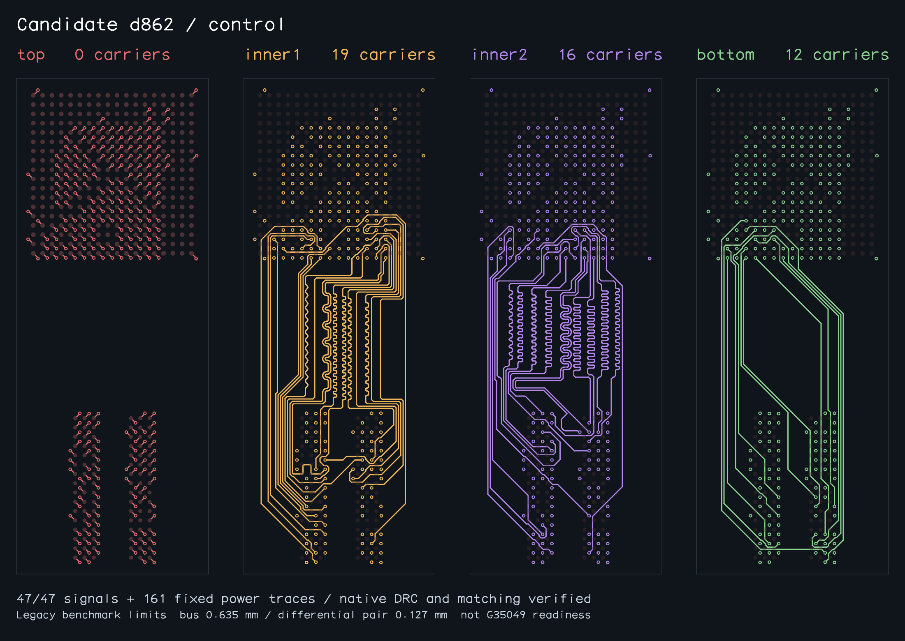

## control-inner1

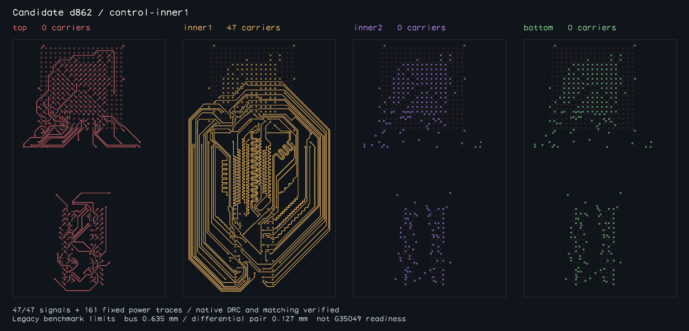

## right

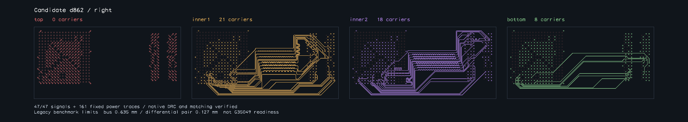

## left

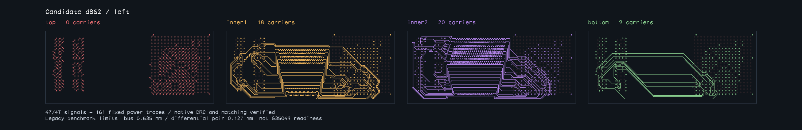

## above

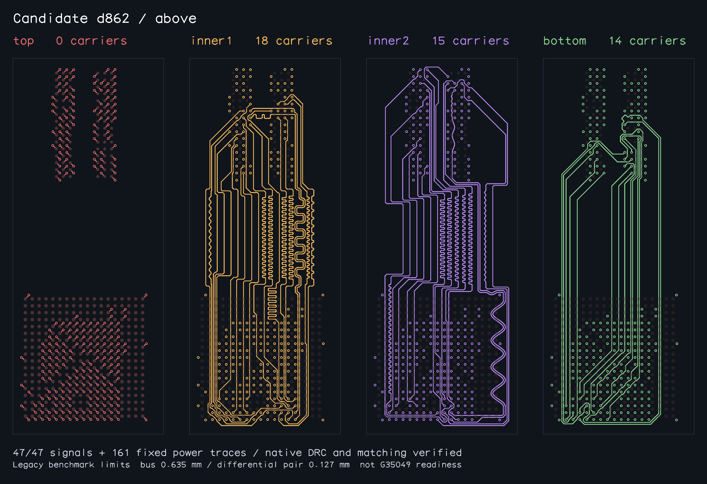

## inner-layers

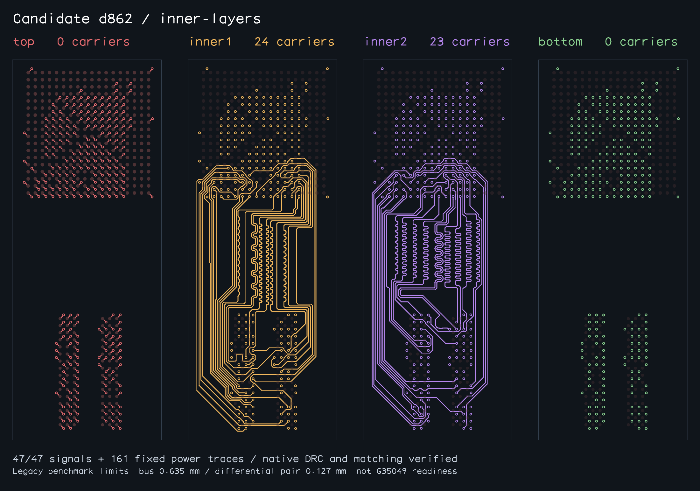

## inner-layers-right

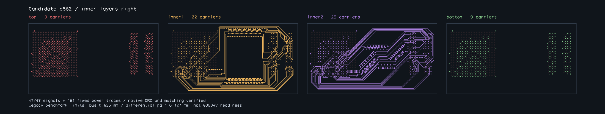

## inner-layers-left

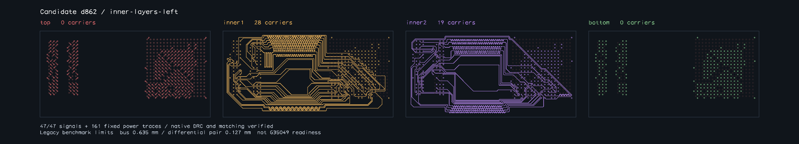

## inner-layers-above

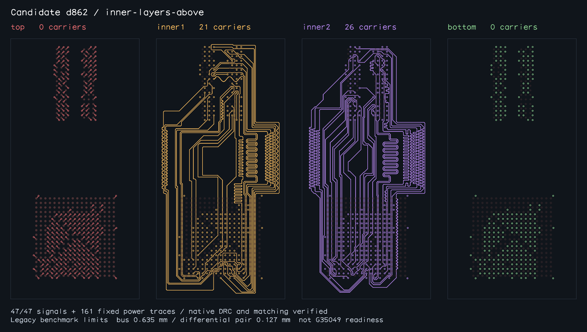

## inner-layers-complete-ca

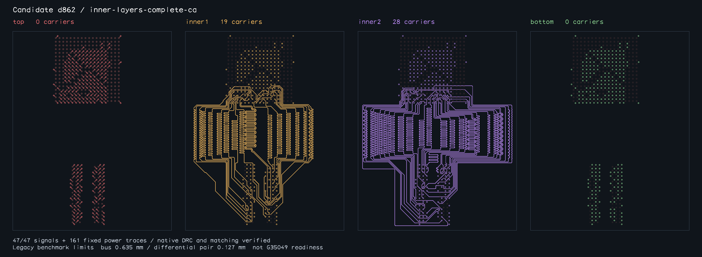

## outer-layers

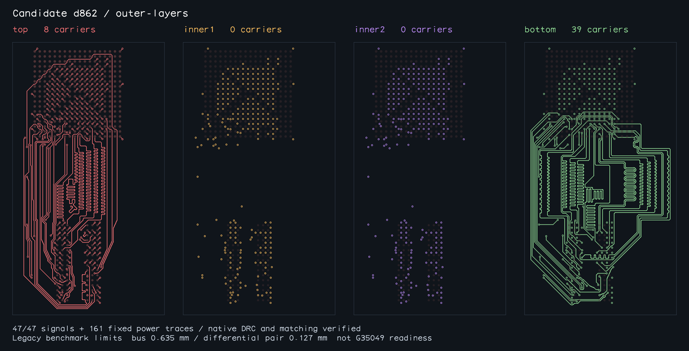
